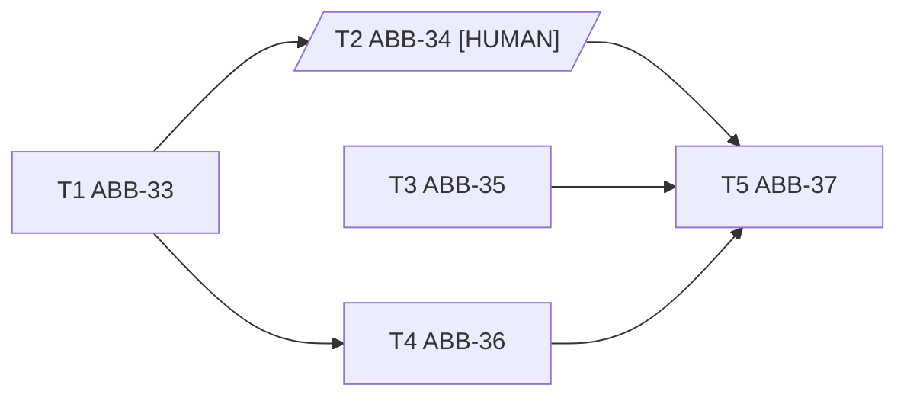

# Ticket graph

Prototype of a deterministic scheduler for implementation tickets: given a folder of tickets and the
list of tickets already merged, it says which tickets can start now, and which of them go to a
sub-agent or to a human.

The same logic exists twice, with identical output:

| Folder | Implementation |
|---|---|
| [`PyGraph/`](PyGraph/) | Python 3.9+ script (`graphlib`, PyYAML) |
| [`GraphNet/`](GraphNet/) | .NET 10 console app (YamlDotNet) |
| [`tickets/`](tickets/) | Five sample tickets |

## The idea

An orchestrator that runs agents on tickets has to answer one question over and over: *what can
start now?* Asking a model to work it out from the tickets gives answers that change from one run
to the next. Here the answer is computed from the tickets alone, so the same tickets and the same
merge state always give the same answer.

### Tickets carry their dependencies

Each ticket is a Markdown file with a `# title` and a YAML block:

````markdown
# T4 — Fallback warning on Windows Server 2016

```yaml
id: T4
key: ABB-36
depends_on: [ABB-33]
base_commit: 3f2e9f02
start_branch: dev
touches: [installer/Steps/Web.ps1, installer/Common/Http.ps1]
```
````

| Field | Meaning |
|---|---|
| `id` | Local id, unique in the folder (`T4`). |
| `key` | Tracker key (`ABB-36`), optional. |
| `depends_on` | Tickets that must be merged before this one starts, by `id` or by `key`. |
| `base_commit` | Commit the ticket was written against. Read, not used yet. |
| `start_branch` | Branch every ticket starts from and merges into. Must be the same for all tickets. |
| `touches` | Files the ticket is expected to change. |

A ticket whose title contains `[HUMAN]` is done by a person (a check on a real server, for
example), not by an agent.

### The tickets form a graph

`depends_on` gives a directed acyclic graph. The sample tickets:



### Waves: the whole plan

A topological sort cuts the graph into waves. Each wave depends only on the waves before it:

```
1. T1, T3
2. T2 [HUMAN], T4
3. T5
```

Waves only depend on the graph. They show the shape of the work, but they are not what runs:
T4 does not need to wait for T3, only for T1.

### Frontier: what can start now

The frontier is the set of tickets that are not merged, not in progress, and whose dependencies
are **all merged**. "Merged" means merged into `start_branch`, not "the agent finished" or "the
PR is open": a ticket starts from the code of its dependencies, so that code must be on the branch.
For a `[HUMAN]` ticket, merged means the person confirmed it is done.

The frontier moves forward with each merge:

| Merged | Frontier |
|---|---|
| — | T1, T3 |
| T1 | T3, T4, T2 (human) |
| T1, T3 | T4, T2 (human) |
| T1, T2, T3, T4 | T5 |

An orchestrator runs this in a loop: read the frontier, start one sub-agent per agent ticket,
notify a person for each human ticket, and compute again after every merge.

### Checks

The graph is refused (exit code 2) when:

- a file has no YAML block, or no `id`;
- two tickets have the same `id`;
- a dependency names a ticket that is not in the folder, or the ticket itself;
- the tickets do not all have the same `start_branch`;
- the graph has a cycle.

When it is valid, the frontier comes with a warning for every pair of agent tickets that would run
at the same time and change the same file — they would conflict at merge time:

```
! T3 et T4 touchent tous les deux ['installer/Common/Http.ps1']
```

The check runs on the frontier, which is what really runs in parallel. That is why tickets have no
hand-written "parallel group": the order comes from `depends_on`, the conflicts from `touches`, and
a group written by hand can only disagree with both.

## Usage

Run from this folder. Both implementations take the same arguments.

```powershell
# Python (needs PyYAML)
python PyGraph/ticket_graph.py tickets/
python PyGraph/ticket_graph.py tickets/ --merged T1,T3 --in-progress T4

# .NET 10
dotnet run --project GraphNet -- tickets/
dotnet run --project GraphNet -- tickets/ --merged T1,T3 --in-progress T4
```

| Option | Effect |
|---|---|
| *(none)* | Waves, frontier and warnings, as text. |
| `--merged IDS` | Comma-separated ids of merged tickets. |
| `--in-progress IDS` | Comma-separated ids of tickets already running. |
| `--mermaid` | Mermaid diagram; merged tickets in green, frontier in yellow. |
| `--json` | Machine output for an orchestrator: `waves`, `frontier.agents`, `frontier.humans`, `warnings`, `tickets`. |

Exit code: `0` valid graph, `2` invalid graph or bad arguments.

`GraphNet/nuget.config` restricts package restore to nuget.org, so a private feed in the global
NuGet configuration does not break the build.

## Differences between the two implementations

The text, Mermaid and JSON outputs are the same, error messages and exit codes included. Two
deliberate differences:

- **Cycle path.** .NET always reports the same path. Python reports the path found by `graphlib`,
  which depends on the iteration order of sets and can change from one run to the next.
- **Unreadable YAML** is a graph error in .NET (exit 2); Python stops with a stack trace.

## Known limitations

- `--merged` and `--in-progress` take local ids only: `--merged ABB-33` is ignored, although
  `depends_on` accepts tracker keys.
- An unknown id in `--merged` or `--in-progress` (typo, wrong case) is silently ignored, so the
  frontier just does not move.
- `touches` is what the ticket author expects; the agent may change other files.
- `base_commit` is read but not checked against the branch.
